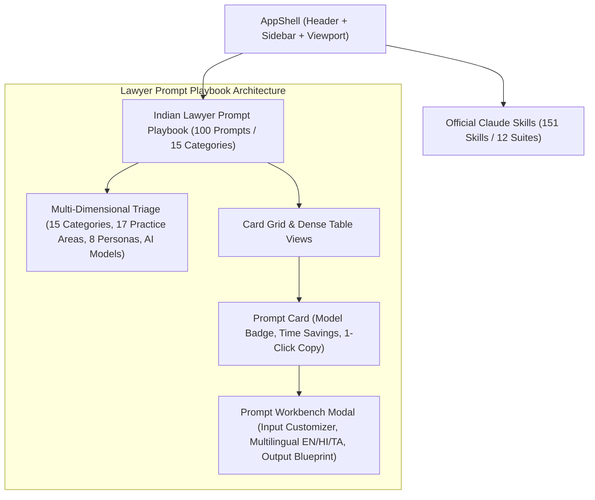

# Indian Legal AI Prompts Playbook: Architecture & Integration Plan

## Executive Summary
This blueprint details the strategy to integrate the **Indian Legal AI Prompt Playbook** (100 commercial prompts across 15 categories, 17 practice areas, and 8 legal personas defined in `Lawyers-BRD1.md` and `Lawyers-BRD2.md`) directly into the existing **Claude Legal Skills Workbench** while preserving its Indian court design identity, zero-persistence privacy architecture, and sub-second performance.

---

## 1. Product Architecture & Scope

### 1.1 Source Provenance & Data Inventory
From `Lawyers-BRD2.md`, exactly **100 premium prompts** are categorized across 15 distinct legal workflows:
1. **Legal Research** (Prompts 1–7): BNS section mapper, PIL viability, DPDPA gap analysis, SEBI tracker, etc.
2. **Case Analysis** (Prompts 8–14): BNSS anticipatory bail, NCLT insolvency plan, CCI anti-trust, etc.
3. **Case Law Summarization** (Prompts 15–21): Ratio decidendi extractor, dissenting opinion, NCLAT summary.
4. **Drafting** (Prompts 22–28): Section 9 ACA petition, Section 138 NI Act notice, Special Leave Petition (SLP).
5. **Litigation** (Prompts 29–35): Written statement, cross-examination, Order 39 interim injunction.
6. **Contracts** (Prompts 36–42): Indian Contract Act indemnity, SHA/SPA clauses, limitation of liability.
7. **Compliance** (Prompts 43–49): DPDPA consent manager, POSH compliance, RBI master direction tracker.
8. **Due Diligence** (Prompts 50–56): M&A red-flag audit, title diligence, environmental regulatory scrutiny.
9. **Arbitration** (Prompts 57–63): Arbitrator conflict of interest, Section 34 challenge, emergency arbitrator.
10. **Client Communication** (Prompts 64–69): Explaining BNSS arrest limits, legal risk matrix for board.
11. **Court Preparation** (Prompts 70–76): Section 63 BSA electronic evidence cross-examination, witness prep.
12. **Evidence Analysis** (Prompts 77–82): Electronic records 65B/63 BSA certificate validation, forensic review.
13. **Legal Marketing** (Prompts 83–87): Case analysis newsletter, LinkedIn thought leadership.
14. **Law Firm Operations** (Prompts 88–94): Realization rate analyzer, associate productivity, conflict check.
15. **AI Agents for Lawyers** (Prompts 95–100): DPDPA breach agent, e-Courts case tracker, contract review agent.

---

## 2. Information Architecture & Navigation Integration

### 2.1 Navigation & Routing
We add a dedicated, first-class route without cluttering the existing 151 official skills:
- **`#/playbook`** (or `#/lawyer-prompts`): Master Playbook Directory.
- **`#/playbook?cat=litigation`**: Direct deep-linking to specific prompt categories.
- **`#/playbook/:id`**: Direct modal/page view for a single prompt (e.g., `#/playbook/lp-008` for BNSS Anticipatory Bail).

### 2.2 Top Header (`CompactHeader.tsx`)
Add a dual-tab toggle in the application header:
- **[§ Claude Skills (151)]** — Official Anthropic engineering skills.
- **[⚖ Lawyer Playbook (100)]** — Bharat legal prompt library with Ashoka gold accent.

### 2.3 Sidebar (`DesktopSkillSidebar.tsx`)
In the sidebar, add an expandable section below Court Skill Suites:
- **Indian Lawyer Playbook (100 Prompts)**
  - Expandable by **15 Categories** (Drafting, Litigation, Research, BNS/BNSS/BSA, etc.)
  - With real-time item counts and category indicators.

---

## 3. Data Engineering & Automation

### 3.1 Extraction Pipeline (`scripts/parse_lawyer_prompts.py`)
A deterministic Python parser will extract the 100 prompts directly from `docs/Lawyers-BRD2.md` and generate `public/data/lawyer_prompts.json`:
- **Validation**: Strict Pydantic schema validation ensuring every prompt has:
  - `id`: Unique slug (`lp-001` to `lp-100`)
  - `number`: 1–100
  - `title`: e.g. "BNS Section Mapper"
  - `category_id`: 1 of 15 canonical categories
  - `practice_area`: e.g. "Criminal Law (BNS)", "Constitutional Law", "Data Protection"
  - `target_personas`: e.g. `["advocate", "senior-counsel"]`
  - `use_case`: Specific lawyer pain point
  - `prompt_template`: Exact parameterized prompt
  - `example_input`: Realistic Indian factual scenario
  - `example_output_structure`: Required markdown/tabular deliverable format
  - `best_ai_model`: `Claude 3.5 Sonnet`, `Claude 3 Opus`, `GPT-4o`
  - `expected_time_savings`: e.g. "30 mins", "2 hours"
  - `language_variants`: `{ "en": "...", "hi": "...", "ta": "..." }`

---

## 4. UI/UX Design & Component Specifications

Following the **Indian Court Design Identity** (`#1E3A8A` Judicial Navy, `#0F172A` Advocate Black, `#D97706` Ashoka Gold, `#B91C1C` Crimson):

### 4.1 Playbook Directory View (`src/features/playbook/PlaybookDirectory.tsx`)
- **Triage Filter Bar**:
  - **Category Pills**: 15 categories with active states and prompt counts.
  - **Persona Selector**: Advocate, Senior Counsel, Corporate Lawyer, In-House Counsel, Student, Ops.
  - **Statute / Practice Area Dropdown**: BNS/BNSS/BSA, Companies Act, Arbitration Act, DPDPA, etc.
  - **AI Model Filter**: Claude 3.5 Sonnet, Claude 3 Opus, GPT-4o.
  - **Keyword Search**: Instant search matching titles, statutes, and prompt templates.
- **Card Grid Layout**:
  - Consistent `h-6` category + persona row.
  - Distinct Model recommendation pill (`Claude 3.5 Sonnet` in purple-blue, `Claude 3 Opus` in amber).
  - Time-savings pill (`⚡ 2 hrs saved`).
  - Multilingual language badges (`EN`, `HI`, `TA`).
  - Full-width prompt snippet with 1-click copy and "Open Workbench" button.
- **Table / List View**:
  - High-density tabular layout for rapid scanning across all 100 prompts.

### 4.2 Interactive Prompt Workbench Modal (`src/features/playbook/PlaybookPromptModal.tsx`)
When a lawyer clicks any prompt:
1. **Interactive Field Customizer**: Parses bracketed inputs like `[Input Section]`, `[Jurisdiction]`, `[Court]` into live editable fields.
2. **Multilingual Switcher**: Tab between English, Hindi, and Tamil variants with 1-click copy.
3. **Execution Instructions**: Notes on model routing (why Claude 3.5 Sonnet is recommended for BNS comparisons vs Claude 3 Opus for complex SHA/SPA drafting).
4. **Sample Deliverable Structure**: Preview of the expected output format (table, legal opinion, petition draft).
5. **Direct Launch**: "Copy & Open Claude" CTA button.

---

## 5. Implementation Roadmap

| Phase | Milestone | Deliverables |
|---|---|---|
| **Phase 1** | **Data Engineering** | Build `scripts/parse_lawyer_prompts.py`, extract 100 prompts, validate schema with Pydantic, generate `public/data/lawyer_prompts.json`. |
| **Phase 2** | **Store & State Management** | Create `src/stores/playbookStore.ts` with instant filtering, search, persona mapping, and bookmarking. |
| **Phase 3** | **Navigation & Shell Integration** | Update `AppShell.tsx`, `CompactHeader.tsx`, and `DesktopSkillSidebar.tsx` to support the dual-mode Workbench / Playbook experience. |
| **Phase 4** | **UI Components** | Build `PlaybookDirectory.tsx`, `PlaybookPromptCard.tsx`, and `PlaybookPromptModal.tsx` with Indian court styling and full interaction states. |
| **Phase 5** | **Testing & Build Verification** | Unit tests in Vitest, schema validation, Pytest checks, and deployment to GitHub Pages. |

---

> [!IMPORTANT]
> The existing 151 official Claude legal skills and their underlying configurations remain 100% intact. The Lawyer Playbook adds a parallel, high-value practice layer tailored specifically for Indian advocates and corporate legal teams.
